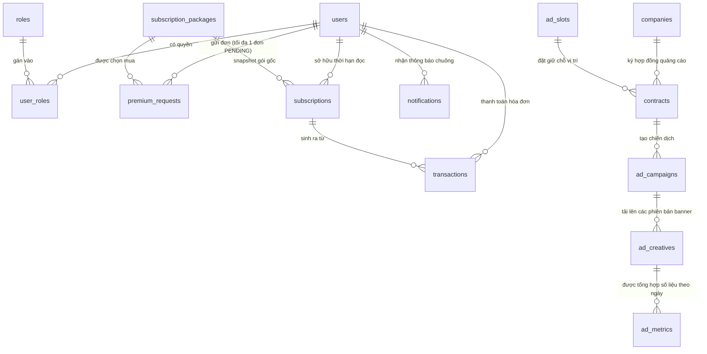

# HÌNH DUNG TOÀN DIỆN VỀ REACT VÀ SƠ ĐỒ CƠ SỞ DỮ LIỆU (BF-01 & BF-08)

---

# PHẦN 1: CODE THỰC TẾ: LÚC BAN ĐẦU (INITIAL RENDER) VS. LÚC VẼ LẠI (RE-RENDER)

Người mới học React thường thắc mắc: *"Đoạn code nào chạy trước, đoạn nào chạy sau? Lúc ban đầu màn hình hiện gì, lúc sau hiện gì?"*

Hãy nhìn vào file thực tế [`PackagesPage.jsx`](file:///c:/Users/Dumpling/Desktop/SWP391-GROUP5/frontend/src/pages/premium/PackagesPage.jsx):

```javascript
export default function PackagesPage() {
  // BƯỚC 1: KHỞI TẠO STATE
  const [state, setState] = useState({ loading: true, packages: [], error: false });

  // BƯỚC 2: KHAI BÁO USEEFFECT (Chưa chạy ngay lúc render đầu tiên!)
  useEffect(() => {
    getActivePremiumPlans().then(packages => {
      setState({ packages: packages, loading: false, error: false }); // <--- Cú hích Re-render
    });
  }, []);

  // BƯỚC 3: PHẦN VẼ GIAO DIỆN (JSX)
  return (
    <main>
      {/* ĐIỀU KIỆN 1: Nếu loading = true thì hiện dòng này */}
      {state.loading && (
        <p role="status">Đang tải gói Premium…</p>
      )}

      {/* ĐIỀU KIỆN 2: Lặp qua mảng packages để vẽ thẻ */}
      <div className="premium-plans">
        {state.packages.map(item => (
          <article key={item.id}>
            <h2>{item.name}</h2>
            <strong>{item.price} VND</strong>
          </article>
        ))}
      </div>
    </main>
  );
}
```

---

### Diễn biến 2 lần vẽ trên trình duyệt:

```
[ THỜI ĐIỂM 1: LÚC BAN ĐẦU (Khi vừa gõ URL /premium/packages) ]
   state.loading  = true
   state.packages = [] (Mảng rỗng)
   
   React duyệt qua mã JSX:
   ✔ {state.loading && ...}  ==> HIỆN CHỮ: "Đang tải gói Premium…"
   ✖ {state.packages.map...} ==> KHÔNG CÓ GÌ VÌ MẢNG ĐANG RỖNG []
   
   👉 Người dùng nhìn thấy: Màn hình trắng có chữ "Đang tải gói Premium…"
   
                      │
                      │ Mất khoảng 100ms: Backend Spring Boot truy vấn MySQL 
                      │ và trả về mảng 3 gói: [{name: "1 Tháng"}, {name: "6 Tháng"}, ...]
                      ▼
   Hàm then() chạy -> Kích hoạt setState({ packages: [...], loading: false })
                      │
                      ▼
[ THỜI ĐIỂM 2: LÚC VẼ LẠI (RE-RENDER SAU KHI DỮ LIỆU ĐÃ VỀ) ]
   state.loading  = false  (Đã đổi!)
   state.packages = [Gói 1, Gói 2, Gói 3]  (Đã có 3 phần tử!)
   
   React tự động quét lại toàn bộ JSX từ trên xuống dưới:
   ✖ {state.loading && ...}  ==> BIẾN MẤT vì loading giờ là false!
   ✔ {state.packages.map...} ==> CHẠY 3 VÒNG LẶP, VẼ RA 3 THẺ GIÁ THẬT!
   
   👉 Người dùng nhìn thấy: Chữ "Đang tải" biến mất, thay bằng 3 khung gói giá đẹp mắt!
```

---

# PHẦN 2: MỘT MÀN HÌNH ĐƯỢC GHÉP TỪ LAYOUT, PAGE VÀ COMPONENT NHƯ THẾ NÀO?

Hãy hình dung giao diện React giống như **trò chơi xếp hình LEGO**. Một màn hình hoàn chỉnh không bao giờ được viết dồn vào một file duy nhất, mà chia thành 3 cấp bậc:

```
┌────────────────────────────────────────────────────────────────────────┐
│ 1. LAYOUT (Khung sườn cố định không bị reload khi chuyển trang)       │
│    File: PublicLayout.jsx                                              │
│                                                                        │
│ ┌────────────────────────────────────────────────────────────────────┐ │
│ │ Header Component: Logo THE PLUSE, Menu Tin tức, Nút Đăng nhập/User  │ │
│ └────────────────────────────────────────────────────────────────────┘ │
│                                                                        │
│ ┌────────────────────────────────────────────────────────────────────┐ │
│ │ 2. PAGE (Màn hình thay đổi theo từng đường dẫn URL)                 │ │
│ │    Ví dụ URL là "/": Nhúng file HomePage.jsx                         │ │
│ │    Ví dụ URL là "/premium/packages": Nhúng file PackagesPage.jsx    │ │
│ │                                                                    │ │
│ │    Bên trong HomePage.jsx lại nhúng các khối nhỏ:                  │ │
│ │    ┌─────────────────────────┐   ┌───────────────────────────────┐ │ │
│ │    │ 3. COMPONENT CON        │   │ 3. COMPONENT CON              │ │ │
│ │    │ File: AdBanner.jsx      │   │ File: NewsTicker.jsx          │ │ │
│ │    │ (Banner quảng cáo đầu) │   │ (Dòng tin tức chạy ngang)     │ │ │
│ │    └─────────────────────────┘   └───────────────────────────────┘ │ │
│ └────────────────────────────────────────────────────────────────────┘ │
│                                                                        │
│ ┌────────────────────────────────────────────────────────────────────┐ │
│ │ Footer Component: Thông tin toà soạn, Giấy phép báo chí, Liên hệ   │ │
│ └────────────────────────────────────────────────────────────────────┘ │
└────────────────────────────────────────────────────────────────────────┘
```

### Minh chứng trong mã nguồn dự án:
Mở file [`AppRoutes.jsx`](file:///c:/Users/Dumpling/Desktop/SWP391-GROUP5/frontend/src/routes/AppRoutes.jsx#L77-L86):
```javascript
// Khung PublicLayout bọc bên ngoài:
<Route element={<PublicLayout />}>
  {/* Khi vào trang chủ "/" -> Nạp HomePage vào giữa Layout */}
  <Route path="/" element={<HomePage />} />
  
  {/* Khi vào bài viết "/articles/:slug" -> Nạp ArticlePage vào giữa Layout */}
  <Route path="/articles/:slug" element={<ArticlePage />} />
</Route>
```
👉 **Lợi ích**: Khi độc giả bấm từ Trang chủ sang Bài viết, thanh **Header (menu)** và **Footer (chân trang)** vẫn đứng yên, chỉ có phần nội dung ruột ở giữa thay đổi. Website lướt cực nhanh và không bị giật nháy màn hình.

---

# PHẦN 3: HOOK LÀ CÁI GÌ? TẠI SAO LẠI GỌI LÀ "MÓC CÂU"?

### 1. Nguồn gốc tên gọi
- Trong tiếng Anh, **Hook** nghĩa là cái **móc câu**.
- Bản thân một hàm JavaScript bình thường chỉ biết nhận tham số rồi tính toán và trả về kết quả. Nó **không có trí nhớ**, **không biết khi nào trang web mở ra**, và **không thể can thiệp vào bộ máy của React**.
- React tạo ra các hàm đặc biệt gọi là **Hook** để cho phép Component của bạn **"móc" (cắm)** vào những tính năng sâu nhất bên trong hệ thống React:

```
[ Component của bạn ]
       │
       ├── móc vào bộ nhớ lưu trữ      ──► useState()
       ├── móc vào sự kiện mở/tắt trang ──► useEffect()
       ├── móc vào thanh địa chỉ URL   ──► useParams()
       ├── móc vào kho đăng nhập chung  ──► useAuth()
       └── móc vào thẻ HTML thật       ──► useRef()
```

### 2. Bảng tra cứu các Hook thường gặp nhất trong dự án:

| Tên Hook | Tác dụng trong đời thực | Ví dụ trong code dự án |
| :--- | :--- | :--- |
| **`useState`** | Tạo "trí nhớ" cho màn hình để tự vẽ lại giao diện khi biến đổi | `const [loading, setLoading] = useState(true);` |
| **`useEffect`** | Lệnh hẹn giờ: "Sau khi vẽ xong màn hình thì tự động gọi API lấy dữ liệu" | `useEffect(() => { getActivePremiumPlans(); }, []);` |
| **`useParams`** | Đọc tham số trên đường link URL | Lấy số `1` từ `/premium/packages/1`<br/>`const { packageId } = useParams();` |
| **`useRef`** | Giữ lại một giá trị bí mật xuyên suốt mà KHÔNG làm màn hình vẽ lại | `const trackedImpressions = useRef(new Set());`<br/>(Dùng để lưu danh sách banner đã xem, tránh đếm trùng) |
| **`useAuth`** *(Custom)* | Móc vào thông tin tài khoản đăng nhập ở bất cứ màn hình nào | `const { user, premiumActive } = useAuth();` |
| **`useReaderPolicy`** *(Custom)* | Kiểm tra xem người đọc này có phải xem quảng cáo hay không | `const { showAdvertising } = useReaderPolicy();` |

---

# PHẦN 4: SƠ ĐỒ CƠ SỞ DỮ LIỆU SAU KHI CHẠY (DATABASE ERD DIAGRAM)

Dưới đây là sơ đồ quan hệ thực tế giữa các bảng trong MySQL 8.4 phục vụ cho 2 luồng **BF-01** (Gói đọc báo) và **BF-08** (Quảng cáo):



---

### Chi tiết các bảng CSDL trọng tâm theo luồng:

#### A. Các bảng thuộc Luồng BF-01 (Premium):
1. **`subscription_packages`**: Bảng gốc khai báo các gói (1 tháng, 6 tháng, 1 năm).
2. **`premium_requests`**: Nơi lưu các đơn đăng ký chuyển khoản ngân hàng:
   - Có cột tự động `pending_user_id` và ràng buộc `UNIQUE` để đảm bảo **mỗi user chỉ có tối đa 1 đơn chờ duyệt** tại một thời điểm.
3. **`subscriptions`**: Bảng chứng nhận quyền đọc báo VIP:
   - Lưu thời hạn: `start_at` $\rightarrow$ `end_at`.
   - Snapshot lại tên gói, giá tiền tại thời điểm mua (`package_name_snapshot`, `price_snapshot`) để sau này toà soạn có tăng giá gói thì hợp đồng cũ không bị sai lệch.
4. **`transactions`**: Hóa đơn điện tử lưu mã giao dịch `txn_ref` (ví dụ `MANUAL-PREMIUM-12`), số tiền và trạng thái `SUCCESS`.
5. **`user_roles`**: Khi Admin duyệt đơn, bảng này sẽ tự chèn thêm `ROLE_SUBSCRIBER` cho người dùng.

#### B. Các bảng thuộc Luồng BF-08 (Quảng cáo):
1. **`ad_slots`**: Danh mục các vị trí hiển thị trên báo (`HOME_HERO`: 970×250, `ARTICLE_SIDEBAR`: 300×600...).
2. **`contracts`**: Hợp đồng B2B của doanh nghiệp, phải có `status = 'ACTIVE'` và `payment_status = 'PAID'` thì quảng cáo mới được phép chạy.
3. **`ad_campaigns`**: Chiến dịch quảng cáo, có trạng thái `ACTIVE` (đang chạy) hoặc `PAUSED` (tạm dừng).
4. **`ad_creatives`**: Lưu ảnh banner (`media_url`) và website đích (`target_url`). Chỉ phiên bản mới nhất có `status = 'APPROVED'` mới được xuất hiện.
5. **`ad_metrics`**: Bảng tổng hợp hiệu quả:
   - Khóa chính phức hợp: `(creative_id, metric_date)`.
   - Lưu trữ số liệu tích lũy: `impressions_count` (lượt xem), `clicks_count` (lượt bấm), `invalid_clicks_count` (click ảo).

---

# PHẦN 5: TÀI LIỆU HÌNH ẢNH CÓ SẴN TRONG THƯ MỤC DỰ ÁN

Để xem các hình ảnh diagram chuẩn do nhóm thiết kế vẽ sẵn bằng đồ họa, bạn hãy mở các file sau trong thư mục dự án:

1. **Sơ đồ kiến trúc tổng quan hệ thống**:  
   👉 [`docs/planning/diagrams/Architecture.png`](file:///c:/Users/Dumpling/Desktop/SWP391-GROUP5/docs/planning/diagrams/Architecture.png)
2. **Sơ đồ quy trình luồng BF-01 (Premium Lifecycle)**:  
   👉 [`docs/planning/diagrams/BF-01.png`](file:///c:/Users/Dumpling/Desktop/SWP391-GROUP5/docs/planning/diagrams/BF-01.png)
3. **Sơ đồ phân phối quảng cáo và đo lường BF-08**:  
   👉 [`docs/planning/diagrams/BF-08.png`](file:///c:/Users/Dumpling/Desktop/SWP391-GROUP5/docs/planning/diagrams/BF-08.png)
4. **Sơ đồ Swimlane phân công trách nhiệm luồng BF-08**:  
   👉 [`docs/planning/diagrams/The_Pluse_BF08_Swimlane_Diagram.png`](file:///c:/Users/Dumpling/Desktop/SWP391-GROUP5/docs/planning/diagrams/The_Pluse_BF08_Swimlane_Diagram.png)
5. **Sơ đồ mối phụ thuộc giữa 8 luồng nghiệp vụ**:  
   👉 [`docs/planning/diagrams/BF-Dependencies.png`](file:///c:/Users/Dumpling/Desktop/SWP391-GROUP5/docs/planning/diagrams/BF-Dependencies.png)

---
*Tài liệu này giải thích trực quan cơ chế hoạt động của React và CSDL MySQL trong dự án SWP391-GROUP5.*
